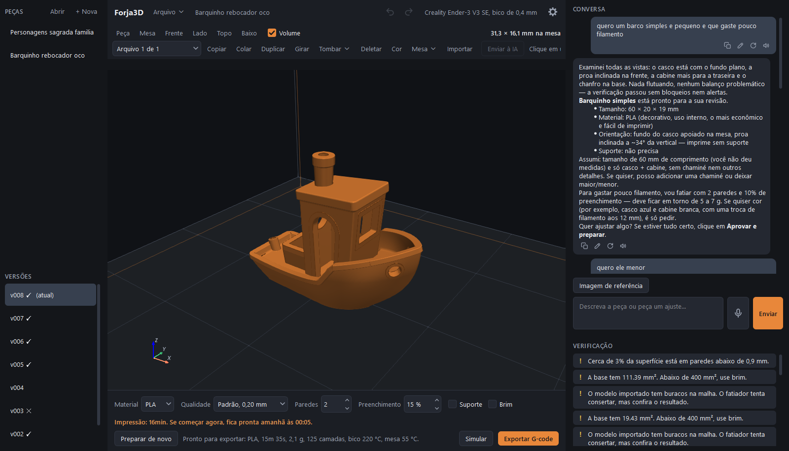
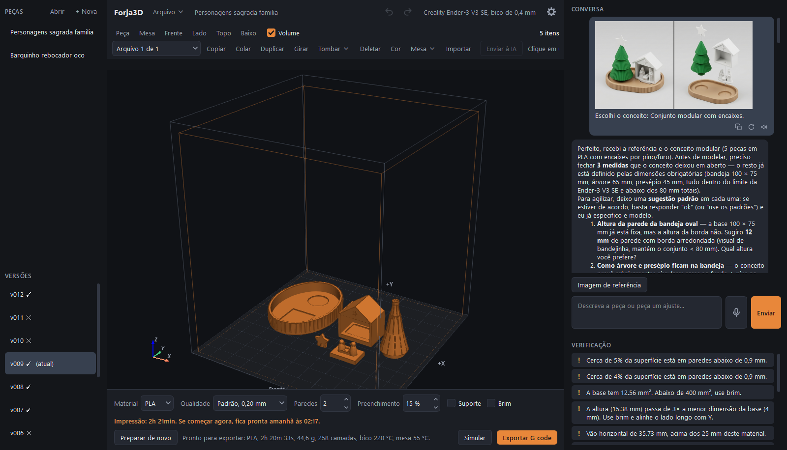

# Forja3D

Descreva uma peça em português, e um agente de IA projeta, verifica e prepara o G-code para a **Creality Ender-3 V3 SE com bico de 0,4 mm**.



## Como instalar

Baixe a versão mais nova em [Releases](https://github.com/rdionny/forja3d/releases): `Forja3D-0.2.0-instalador.exe` para Windows ou `Forja3D-0.2.0-linux-x64.tar.gz` para Linux. No Linux, veja **No Linux**, mais abaixo.

No Windows, rode o instalador. Não precisa de Python nem de permissão de administrador: o programa fica só no seu usuário, em `%LOCALAPPDATA%\Programs\Forja3D`, com o OrcaSlicer junto.

- **Aviso do Windows:** o instalador não tem assinatura digital, então o SmartScreen pode dizer que protegeu o computador. Se você confia em quem mandou o arquivo, clique em **Mais informações** e em **Executar assim mesmo**.
- **Primeiro uso:** o app abre em **Configurações**. Informe o endpoint e a chave do seu provedor de IA, clique em **Testar conexão** e escolha o modelo. O provedor precisa ser compatível com a API da OpenAI. Se cancelar, o app abre sem a IA, e dá para configurar depois pelo ícone de engrenagem.
- **Arquivos `.forja3d`:** dois cliques abrem o projeto no app, mesmo que ele já esteja aberto. Se ele estiver trabalhando, o arquivo abre quando a tarefa terminar.
- **Placa de vídeo:** o visualizador 3D precisa de OpenGL 3.2 ou mais novo. Qualquer driver de vídeo atualizado atende.

Suas peças ficam em `Documentos\Forja3D`, e a configuração, com a chave, em `%APPDATA%\Forja3D`. Desinstalar não apaga essas pastas: apague-as à mão se quiser remover tudo.

## Como abrir pelo código

Dê dois cliques em `Abrir Forja3D.bat`. O canto direito da barra de baixo mostra a versão e a data da atualização, como "Forja3D 0.2.0, atualização de 17/11/2026 23:04". Pelo código, a data é a do arquivo mudado por último. Se o código mudou depois que a janela abriu, feche e abra de novo.

Em uma máquina nova:

```powershell
py -3.11 -m venv .venv
.venv\Scripts\python.exe -m pip install -r requirements.lock
```

Copie `config/ia_padrao.example.toml` para `config/ia_padrao.toml` e preencha a chave. O OrcaSlicer portátil fica em `ferramentas/OrcaSlicer_2.4.2/`, ou indique outro caminho em **Configurações**.

### Em outra máquina, com tudo o que há nesta

O repositório `rdionny/forja3d` é privado e tem dois ramos que se completam. O ramo do código não leva a chave da API nem as suas peças. O ramo `dados-pessoais` guarda só o que fica fora do git de propósito: `config/ia_padrao.toml`, com a chave, `config/config_do_app.toml`, que é a cópia da configuração do app, `PLANEJAMENTO.md` e `PROMPT_DESENVOLVIMENTO.md`, que citam a chave, e as pastas `projetos/` e `saida/`.

```powershell
git clone https://github.com/rdionny/forja3d.git
cd forja3d
git restore --source=origin/dados-pessoais --worktree -- config/ia_padrao.toml config/config_do_app.toml PLANEJAMENTO.md PROMPT_DESENVOLVIMENTO.md projetos saida
New-Item -ItemType Directory -Force "$env:APPDATA\Forja3D" | Out-Null
Copy-Item config\config_do_app.toml "$env:APPDATA\Forja3D\config.toml"
py -3.11 -m venv .venv
.venv\Scripts\python.exe -m pip install -r requirements.lock
.venv\Scripts\python.exe scriptsaixar_orca.py
```

- **O que não vai para o GitHub:** `.venv/`, `build/` e `dist/`, que os comandos acima e `scripts\gerar_instalador.py` refazem, e `ferramentas/`, que `scriptsaixar_orca.py` baixa do site oficial e confere pelo SHA-256. O OrcaSlicer tem arquivos acima do limite de 100 MB do GitHub.
- **Configuração do app:** os provedores de IA e as chaves que você cadastrou em **Configurações** ficam em `%APPDATA%\Forja3D\config.toml`, fora desta pasta. `config/config_do_app.toml` é uma cópia desse arquivo, e os dois últimos comandos acima a põem no lugar. Ela guarda os caminhos desta máquina: se a pasta do projeto for outra, acerte **OrcaSlicer** e **Pasta das peças** em **Configurações**.
- **Para guardar peças novas:** o ramo `dados-pessoais` é uma foto do dia em que foi enviado. Ele não acompanha as peças que você criar depois.
- **Nunca torne este repositório público:** o ramo `dados-pessoais` tem a sua chave. Para publicar o programa, envie só o ramo do código para outro repositório.

### No Linux

A cada envio, o GitHub Actions roda a suíte inteira no Ubuntu e no Windows. O pacote do Linux é testado fazendo o CAD e a verificação de um cubo. Ninguém abriu a janela em um Linux com tela de verdade ainda: os testes rodam sem tela.

**Pacote pronto**, para Ubuntu 22.04 ou mais novo, em x64: baixe `Forja3D-0.2.0-linux-x64.tar.gz` em [Releases](https://github.com/rdionny/forja3d/releases).

```bash
tar -xzf Forja3D-0.2.0-linux-x64.tar.gz
./Forja3D/Forja3D
```

**Pelo código:**

```bash
python3.11 -m venv .venv
.venv/bin/python -m pip install -r requirements.lock
./abrir_forja3d.sh
```

Nos dois casos, instale os pacotes do sistema: `sudo apt install libegl1 libxcb-cursor0 alsa-utils espeak-ng`. Os dois primeiros são da janela. O `alsa-utils` traz o `arecord`, que grava o microfone. O `espeak-ng` lê as mensagens em voz alta.

| Recurso | No Linux |
|---|---|
| Conversa, CAD, verificação e vistas da peça | Funcionam, com os mesmos testes do Windows |
| Mesa 3D interativa | Precisa de OpenGL 3.2. Os testes rodam com ela desligada, nos dois sistemas |
| Áudio no chat | Grava pelo `arecord`. Sem ele, o app avisa. Testado com microfone de verdade só no Windows |
| Ler em voz alta | Usa o `espeak-ng`. Sem ele, o app avisa |
| Abrir um `.forja3d` com o app aberto e o aviso do MCP para a janela | Funcionam, por socket Unix |
| Fatiar | O OrcaSlicer não vem junto. Baixe o AppImage da [versão 2.4.2](https://github.com/SoftFever/OrcaSlicer/releases/tag/v2.4.2), dê permissão de execução (`chmod +x`) e indique o arquivo em **Configurações > OrcaSlicer**. Os testes que fatiam de verdade só rodam no Windows |
| Exportar para o cartão SD | O app não sugere o cartão: escolha a pasta dele na janela de salvar |
| Limite de 4 GB de memória do CAD | Só no Windows. No Linux, um script da IA que gaste memória demais não é interrompido |
| Instalador e `scripts/baixar_orca.py` | Só no Windows |

A configuração fica em `~/Forja3D/config.toml`. Pelo pacote, as peças ficam na pasta Documentos, em `Forja3D`. Se o app não abrir, a mensagem aparece no terminal e os detalhes ficam em `~/Forja3D/logs/falha_ao_abrir.txt`.

## Como usar

1. Descreva a peça na conversa, com as medidas que tiver. Para falar em vez de digitar, clique no **microfone** ao lado de **Enviar**, fale e clique no quadrado: o texto transcrito aparece no campo, para você revisar antes de enviar. O endereço do servidor de transcrição, compatível com a OpenAI e sem chave, fica em **Configurações > Transcrição de áudio**.
2. Acompanhe a peça no visualizador e a verificação abaixo da conversa. Peça ajustes pelo chat.
3. Escolha material, qualidade, paredes e preenchimento, e clique em **Aprovar e preparar**.
4. Clique em **Exportar G-code** e salve no **cartão SD**. A impressora não lê pen drive.

### Na mesa

- **Mover:** clique em um item e arraste. A vista **Topo** é a melhor para posicionar. O que está na mesa é o que vai imprimir.
- **Câmera:** arraste o espaço vazio para girar, use a roda para aproximar e Shift + arrastar para mover a vista.
- **Copiar e cia.:** com o item selecionado, use os botões ou Ctrl+C, Ctrl+V, Ctrl+D (duplicar), R (girar 90°) e Delete. O botão direito abre o mesmo menu. Deletar tira só da mesa: o modelo continua igual, e o botão **Mesa** adiciona a parte de novo.
- **Deitar uma peça:** selecione o item e clique em **Tombar**. O menu deita a 90° em quatro direções, e **Outro ângulo…** aceita qualquer valor, como 120°. **Voltar à posição original** desfaz tudo de uma vez. O modelo não muda, e a mesa, as cores por altura e o G-code passam a usar a nova posição. A 90°, uma peça de faces retas fica apoiada em uma face. Em outros ângulos, ela encosta em uma aresta: o app avisa, e ao preparar sem **Suporte** pede confirmação.
- **Desfazer e refazer:** use os ícones no topo, Ctrl+Z e Ctrl+Y. Valem para as alterações na mesa da versão aberta, até trocar de versão ou de peça.
- **Arquivos diferentes:** em **Mesa > Mover para o arquivo**, separe os itens para imprimir em outro momento. Cada arquivo vira um G-code. O que não couber em um arquivo vai sozinho para outro.
- **Pedir um ajuste em uma parte:** selecione o item e clique em **Enviar à IA**. A próxima mensagem do chat vai falar só daquela parte, e o agente recebe as vistas dela e, se a peça veio de uma imagem, a imagem de referência e o conceito.
- **Tempo:** depois de preparar, o app mostra quanto a impressão demora e a que horas fica pronta se começar agora. É a estimativa do OrcaSlicer, que não conta aquecimento nem nivelamento.

Mudar a mesa invalida o G-code preparado: é preciso clicar em **Aprovar e preparar** de novo.

### Importar um modelo baixado

Para colocar na mesa um modelo que você baixou, clique em **Importar**, na barra da mesa, use **Arquivo > Importar modelo 3D** (Ctrl+I) ou arraste o arquivo até a mesa. Ele entra na peça aberta, junto do que já está lá. Com nenhuma peça aberta, vira uma peça nova, e nada disso passa pela IA. Vários arquivos selecionados juntos viram uma peça só, com uma cor para cada um: veja **Cores**, abaixo.

| Formato | Situação |
|---|---|
| STL, GLB, glTF, OBJ, 3MF, PLY, OFF | Aceitos |
| FBX | Aceito em formato binário, que é o comum. A malha entra na pose de repouso |
| USDZ, BLEND | Ainda não. O app avisa, e o mesmo modelo costuma estar disponível em STL ou GLB no site de onde veio |

Antes de ir para a mesa, uma janela mostra o modelo e pede a altura e a orientação. Use **Tombar** se ele vier deitado. O app não deixa passar da área segura da impressora e sugere um tamanho quando a medida do arquivo não faz sentido.

O app conserta o que dá sem mudar a forma: tampa buracos, como o fundo aberto de um modelo oco, acerta faces invertidas e reduz modelos acima de 600 mil triângulos, que o bico de 0,4 mm não aproveitaria.

- **Só a forma vai para a impressão.** Cor e textura ficam de fora, e um rosto que existe só na textura não aparece na peça. Antes de baixar, olhe o modelo sem textura no site.
- **A IA não altera o modelo importado.** Ela sabe que ele está na mesa e pode criar peças novas que encaixem nele. O modelo continua nas versões seguintes, e o arquivo `.forja3d` o leva junto.
- **Verificação:** o modelo não é comparado com a especificação. Tamanho, altura e apoio na mesa continuam impedindo a impressão. Buracos que não deu para fechar e paredes finas viram avisos, porque não há script para corrigir, e o G-code é validado como o de qualquer peça.

### Cores

A impressora tem um bico só, então cada cor nova é uma pausa em que você troca o filamento. Selecione um item na mesa e clique em **Cor**. O app deixa o G-code pronto: não precisa abrir o arquivo para editar nada.

| Forma | Trocas | Quando usar | Onde fica |
|---|---|---|---|
| Um arquivo por cor | Nenhuma | Peças separadas, como uma árvore verde e uma estrela branca | **Mesa > Um arquivo por cor** |
| Por altura | Uma em cada altura | A peça inteira muda de cor a partir de um ponto, como letras em relevo sobre uma placa | **Mesa > Trocar a cor em uma altura** |
| Só a primeira camada colorida | Uma a menos que o número de cores | Logo ou placa fina com várias cores, virada para a mesa | Em **Cor**, ou ao importar |
| Em todas as camadas | Uma por cor em cada camada | Só em peças muito baixas: em uma peça alta, seriam centenas de pausas | Em **Cor**, sem marcar a primeira camada |
| Peças que encaixam | Nenhuma | Modelo baixado de uma cor só, como um boneco com olhos e bochechas | **Mesa > Separar em peças por cor** |

Antes de preparar uma mesa com mais de 12 trocas, o app avisa e oferece separar um arquivo por cor.

**Separar em peças por cor:** selecione um modelo importado e use **Mesa > Separar em peças por cor…**. A peça aparece sozinha, com o contorno de cada região, que é um pedaço da superfície cercado por quinas. Escolha a **Cor do clique** e clique nas regiões: clicar de novo tira a pintura, e vizinhas da mesma cor saem juntas. **Separar** cria uma versão nova, em que o corpo fica com um rebaixo de 2 mm em cada região e cada região pintada vira uma parte própria, com 0,15 mm de folga, já na posição de imprimir e com cada cor em um arquivo. Imprima cada arquivo no filamento dele e encaixe as peças no corpo.

- **Pino de encaixe:** vem marcado, e trava a peça em um furo do corpo. Com face plana, a peça imprime com a face na mesa e o pino para cima. Com face curva, ela imprime com o pino para baixo: o app avisa quais são, e é preciso marcar **Suporte**. Sem o pino, a peça entra só no rebaixo e imprime deitada no fundo plano, sem suporte.
- **O que não separa:** a maior região, que é o corpo, regiões com menos de 3 mm², uma região que dá a volta na peça, como a lateral de um cilindro, e um modelo liso de ponta a ponta, sem quinas. Vale só para modelo importado de um corpo só: a peça do agente muda pelo chat, e a de vários corpos já vem separada.
- A ideia vem de um vídeo da SuaFarm3D. O encaixe não foi testado em impressão real: se ficar justo ou folgado, a folga é `FOLGA_MM`, em `src/forja3d/importacao/separacao.py`.

**Pedindo ao agente:** escreva no chat, por exemplo, "deixa a tampa preta e os nomes em branco". Ele aplica a cor e a troca por altura sem gerar outra versão, e, se a parte divide o arquivo com outras, coloca-a em um arquivo próprio. Depois, clique em **Aprovar e preparar**. A cor muda por camada, então o agente recusa o que isso não resolve, como um detalhe na lateral ou um rosto. As vistas que ele recebe não mostram cor: ele confere pelas medidas da peça, e você confere em **Simular**.

**Para um logo em várias cores:** clique em **Importar** e selecione juntos os arquivos do modelo, um por cor, como `black.stl`, `red.stl` e `white.stl`. Eles ficam alinhados como foram desenhados e viram uma peça só, e o nome de cada arquivo já sugere a cor. Em peças de até 10 mm, a opção **Só a primeira camada colorida** vem ligada: todas as cores ficam na camada que encosta na mesa, e o resto da peça sai na cor de fundo. A face colorida é a de baixo: se ela estiver para cima, use **Tombar** duas vezes. Para colorir um logo, os corpos não podem se sobrepor na primeira camada, e a cor de fundo precisa encostar na mesa.

**Na impressora:** depois de preparar, a verificação mostra o roteiro: com que cor começar, o que colocar em cada troca e quantos gramas de cada cor a peça usa. Ao exportar, esse roteiro vai em um arquivo `.txt` ao lado do G-code. Em cada pausa, a cabeça sobe e vai para o canto. Aperte a alavanca do extrusor, tire o filamento, coloque a próxima cor até sair plástico e aperte para retomar no visor. A impressora purga sozinha e volta para a peça. O bico fica quente na pausa.

Com cores na mesma camada, o app também imprime uma torre de purga em um canto livre, que limpa o bico antes de voltar para a peça. Por isso, deixe espaço na mesa. A torre só entra quando há mais de uma cor na mesma preparação.

A técnica vem de um [tutorial feito nesta impressora](https://www.youtube.com/watch?v=hMwTHFgIkjY), com um ajuste para peças altas: a rotina volta para a altura em que estava antes de seguir, e acima de 2 mm a purga é feita no ar, no canto, porque descer até a mesa levaria a cabeça contra a peça. Nesse caso, sai um fio de plástico: tire com uma pinça antes de a impressão continuar.

### Simular a impressão

Depois de **Aprovar e preparar**, clique em **Simular**. A mesa mostra o caminho do bico, lido do mesmo G-code que vai para o cartão SD, com a cor de cada filamento.

- **Barra:** arraste para ir a qualquer momento da impressão. Acima dela aparecem a porcentagem, a camada, a altura e o tempo.
- **Reproduzir:** a impressão anda sozinha, em três velocidades. Como a impressora, a simulação para em cada troca de filamento e diz qual cor colocar. **Próxima troca** vai direto para a pausa seguinte.
- **Voltar à mesa:** fecha a simulação. Enquanto ela está aberta, não dá para mexer nas peças. Preparar de novo, mudar as opções ou mandar um pedido à IA também a encerram.

Com vários arquivos, a simulação é a do arquivo que está na tela. O tempo é a estimativa do OrcaSlicer, sem contar as pausas. As linhas mostram o caminho do bico, não a largura real do plástico, e o filamento preto aparece em cinza, para não sumir no fundo escuro.

### Na conversa

Cada mensagem tem uma barra com quatro ações:

- **Copiar:** leva o texto para a área de transferência.
- **Editar:** abre a mensagem para você reescrever. Em uma resposta, abre a pergunta que a gerou.
- **Enviar de novo:** refaz a resposta. Em uma resposta, reenvia a pergunta que a gerou.
- **Ler:** lê em voz alta com a voz do Windows, sem mandar o texto para fora do computador. Clique de novo para parar.

Editar e enviar de novo voltam a conversa até aquela mensagem: o que veio depois sai da conversa, e a peça volta para a versão daquele momento. As versões mais novas continuam na lista, e uma cópia da conversa antiga fica em `conversas_anteriores/`, na pasta do projeto. Antes de tirar outros pedidos da conversa, o app pergunta.

### Na lista de peças

Clique com o botão direito em uma peça para **renomear**, **fixar no topo** ou **apagar**. Apagar manda a pasta do projeto para a Lixeira do Windows, de onde ela ainda pode voltar.

### Salvar e compartilhar

O app guarda tudo sozinho: instalado, em `Documentos\Forja3D`; rodando pelo código, na pasta `projetos/`. Para levar um projeto para outro lugar ou passar para outra pessoa, use o botão **Arquivo**, ao lado do nome do programa:

- **Salvar** (Ctrl+S): grava no arquivo escolhido antes. Na primeira vez, pergunta onde.
- **Salvar como** (Ctrl+Shift+S): escolhe outro local ou nome. Também está no botão direito da lista de peças.
- **Abrir arquivo** (Ctrl+O): cria na sua lista uma cópia do projeto que está no arquivo `.forja3d`. Também há o botão **Abrir**, acima da lista.

O arquivo leva a conversa, as versões, a mesa, os modelos importados e as imagens de referência. Veja se não há nada na conversa que você prefira não passar adiante.

Ele não leva o G-code, a verificação, a chave da API nem as conversas descartadas. Quem abre tem a peça verificada de novo no próprio computador e prepara o G-code lá. Só a versão atual é verificada ao abrir: as outras são verificadas quando a pessoa voltar para elas.

### A partir de uma imagem

Também dá para começar por uma imagem: clique em **Imagem de referência**, ou arraste e cole a imagem no chat. O app mostra pelo menos 2 opções de conceito, cada uma com a peça montada e a vista explodida. Depois da escolha, o agente pergunta o que faltar e modela a peça. As imagens são só ilustração e não têm medidas reais.



## Usar com o Claude ou o Codex (MCP)

O Forja3D também funciona como servidor MCP: o Claude, o Codex ou outro agente compatível modela com as mesmas ferramentas do agente do app. Quem pensa é o agente de fora, então o Forja3D não usa a sua chave de IA nesse caso.

| Ferramenta | O que faz |
|---|---|
| `ler_regras` | As regras de modelagem: impressora, materiais, CadQuery e o fluxo. O agente lê antes de modelar |
| `listar_pecas`, `criar_peca`, `ver_peca` | Acha, cria e lê uma peça, inclusive o script da versão atual |
| `definir_especificacao`, `executar_cad`, `verificar_peca`, `renderizar_vistas` | O mesmo fluxo do agente do app. As vistas voltam como imagem |
| `definir_cores`, `voltar_para_versao` | Cores por troca manual e volta para uma versão antiga |
| `fatiar_peca` | Só depois de você aprovar a versão no app |

As travas são as mesmas do app, e ficam no código: especificar antes de modelar, verificar antes de mostrar e fatiar só o que você aprovou. **Aprovar e exportar o G-code continua sendo só seu, no app.** As peças ficam na mesma pasta do app. Cada versão nova entra na lista, o chat da peça registra o que o agente de fora fez, e a janela aberta relê a peça sozinha.

**Ligar e desligar:** em **Configurações**, na parte **Agentes de fora (MCP)**. Ao salvar com a opção marcada, o app coloca o Forja3D no `config.toml` do Codex. Com a opção desmarcada, ele tira o Forja3D de lá, e o servidor recusa toda ferramenta, mesmo que algum agente ainda o abra. Só o bloco `[mcp_servers.forja3d]` muda: o resto do arquivo fica igual, uma cópia de antes fica em `config.toml.antes-do-forja3d`, e se o arquivo tiver um formato que o app não saiba editar com segurança, nada é gravado. Depois de ligar, abra uma conversa nova no Codex, porque ele carrega os servidores no começo de cada conversa. O botão **Copiar o comando do Claude Code** copia o comando abaixo.

**Codex, à mão:** acrescente em `%USERPROFILE%\.codex\config.toml`:

```toml
[mcp_servers.forja3d]
command = 'C:\Users\Rafael\Documents\Impressora 3d\.venv\Scripts\python.exe'
args = ['C:\Users\Rafael\Documents\Impressora 3d\scripts\servidor_mcp.py']
env_vars = ["APPDATA", "LOCALAPPDATA", "USERPROFILE", "TEMP", "TMP"]
startup_timeout_sec = 60
tool_timeout_sec = 900
```

**Claude Code:**

```powershell
claude mcp add forja3d --scope user -- "C:\Users\Rafael\Documents\Impressora 3d\.venv\Scripts\python.exe" "C:\Users\Rafael\Documents\Impressora 3d\scripts\servidor_mcp.py"
```

**Claude Desktop:** em `%APPDATA%\Claude\claude_desktop_config.json`, dentro de `"mcpServers"`, acrescente `"forja3d": {"command": "<python.exe acima>", "args": ["<servidor_mcp.py acima>"]}`, com as barras dobradas.

Troque `C:\Users\Rafael\Documents\Impressora 3d` pela pasta do projeto, se ela for outra. Depois, peça normalmente, por exemplo: "use o Forja3D para criar um suporte de parede para um roteador de 180 × 120 mm".

- **Tempo:** modelar e fatiar pode levar minutos. Por isso o `tool_timeout_sec` do Codex é maior que o padrão, de 60 s.
- **Um agente por peça:** não deixe o agente do app e o de fora mexerem na mesma peça ao mesmo tempo. Um pode gravar por cima do outro.
- **Instalado:** o `Forja3D.exe` também aceita `--mcp`, mas só a partir da próxima geração do instalador.

## O que protege a peça e a impressora

| Etapa | O que confere |
|---|---|
| Especificação | Tamanho e material, antes de modelar |
| Verificação geométrica | Medidas, furos, sólido válido, paredes finas, balanços e pontes |
| Crítica visual | O agente olha as vistas da peça |
| Validação do G-code | Movimentos na mesa, temperaturas, comandos permitidos |

A IA nunca escreve G-code e não tem como exportar arquivos: isso depende do seu clique.

## Limites conhecidos

- **Segurança do código da IA:** o script gerado passa por uma análise, roda em processo separado, com tempo e memória limitados e sem a chave da API. Isso reduz bastante o risco, **mas não é uma sandbox completa**.
- **Arquivo de outra pessoa:** tudo é conferido ao abrir, nada do arquivo é executado, e o G-code é sempre gerado e validado no seu computador. Mesmo assim, o script e a conversa do arquivo vão para o agente como contexto, e um texto mal-intencionado ainda pode tentar influenciar o modelo. Abra só arquivos de quem você conhece.
- **Modelagem orgânica:** o agente desenha com CAD paramétrico, que serve para peças técnicas. Rostos e figuras humanas saem como blocos, cones e cilindros. Para isso, gere o modelo em uma ferramenta própria, como a Meshy, e importe na mesa.
- **Cores:** a rotina de pausa do tutorial foi testada nesta impressora pelo autor dele. Os ajustes do Forja3D, como a volta para a altura e a purga no ar, ainda não foram impressos. Faça a primeira troca acompanhando, com uma peça pequena. Todas as cores de um arquivo usam o mesmo material, e a estimativa de tempo não conta as pausas.
- **Modelo baixado:** a leitura roda em processo separado, com tempo e memória limitados, e nada do arquivo é executado. Mesmo assim, baixe de sites em que você confia.
- **Chave da API:** o endpoint padrão usa HTTP sem criptografia, então a chave e os pedidos trafegam em texto aberto. Ela fica em `config/ia_padrao.toml`, fora do Git e fora do instalador. Para trocar, use **Configurações**.
- **Impressão:** enquanto a calibração não for feita, folgas e furos usam valores iniciais comuns em FDM. Encaixes podem precisar de ajuste.
- **Sem sensor de fim de filamento:** confira se o carretel tem o bastante antes de imprimir.

## Desenvolvimento

```powershell
.venv\Scripts\python.exe -m pytest
.venv\Scripts\python.exe -m pytest -m ao_vivo
.venv\Scripts\python.exe scripts\sincronizar_prompt.py
.venv\Scripts\python.exe scripts\testar_endpoint.py
```

O primeiro comando roda os testes sem usar a IA. O segundo usa o endpoint real. O terceiro é necessário depois de editar `PROMPT_AGENTE_3D.md`. O quarto confere se o endpoint responde a texto, ferramentas, leitura de imagem, streaming e geração de imagem.

Para atender a um pedido pelo terminal, sem interface:

```powershell
$env:PYTHONPATH = "src"
.venv\Scripts\python.exe -m forja3d agente "Cubo de 20 mm em PLA"
```

Veja `PLANEJAMENTO.md`, `PROMPT_DESENVOLVIMENTO.md`, `docs/decisoes-fase0.md` e `docs/imagem-de-referencia.md`.

## Gerar o instalador

Precisa do [Inno Setup 6](https://jrsoftware.org/isinfo.php) (`winget install JRSoftware.InnoSetup`) e de cerca de 5 GB livres.

```powershell
.venv\Scripts\python.exe scripts\gerar_instalador.py
```

O resultado fica em `dist\instalador\`. O script faz, em ordem:

1. **OrcaSlicer:** usa `ferramentas/download/OrcaSlicer_Windows_V2.4.2_x64_portable.zip`, ou baixa do GitHub se ele não existir, e para se o SHA-256 não for o fixado no script. Extrai em `build/orca/`, nunca da pasta de trabalho, que acumula logs.
2. **Pacote:** roda o PyInstaller com `instalador/forja3d.spec` e gera `dist/Forja3D/`. O CAD e as vistas reabrem o próprio `Forja3D.exe` com `--worker-cad` e `--worker-render`.
3. **Conferência:** `scripts/conferir_pacote.py` procura as chaves e os endpoints deste computador em todos os arquivos, inclusive dentro do `.exe` e de ZIPs, sem nunca imprimi-los. Também recusa arquivos proibidos, confere a lista branca e acusa DLLs que só existem neste computador.
4. **Instalador:** roda o Inno Setup com `instalador/forja3d.iss`, instala em uma pasta temporária, confere de novo o que foi instalado e desinstala.

Para gerar só o pacote, sem o Inno Setup, use `--sem-instalador`.

**Pelo GitHub:** suba a versão em `pyproject.toml` e em `src/forja3d/versao.py`, escreva as novidades em `.github/notas_da_versao.md` e envie uma tag, como `git tag v0.2.0` seguido de `git push origin v0.2.0`. O workflow `.github/workflows/release.yml` cria o release, roda este mesmo script no Windows e anexa o instalador. Ele também empacota o Linux com o mesmo spec, procura segredos, testa o executável e anexa o `.tar.gz`. Lá não existe `config/ia_padrao.toml`, então a chave não tem como entrar nos pacotes.

- **Ícone e logo:** os desenhos ficam em `src/forja3d/interface/icones/`. O ícone do exe, do instalador e dos arquivos `.forja3d` sai de `forja3d.svg`, `forja3d_medio.svg` e `forja3d_pequeno.svg`, um para cada faixa de tamanho, e a tela de abertura usa `logo.svg`.
- **O que entra:** o que não é código está em `instalador/lista_do_pacote.py`, uma lista branca. A pasta `config` inteira levaria a chave. O instalador usa `config/ia_padrao.pacote.toml`, sem endpoint, chave nem modelo.
- **Teste sem chave:** `scripts/ia_de_teste.py` é um endpoint de mentira, que responde sempre o mesmo roteiro de um cubo de 20 mm. Serve para testar o app instalado, inclusive em uma máquina virtual, sem gastar nada. Não prova que um provedor real responde.
- **O que os testes não pegam:** a conferência acha a causa mais comum de falha, mas só um Windows limpo prova que o instalador funciona. Faça esse teste antes de passar uma versão nova adiante.
- **Licença do OrcaSlicer:** ele vai junto, sem alteração, como programa separado, sob a AGPL-3.0. O instalador leva a licença dele e `TERCEIROS.txt`, com o link do [código-fonte da versão 2.4.2](https://github.com/SoftFever/OrcaSlicer/tree/v2.4.2). Ao trocar de versão, atualize o link, o nome do ZIP e o SHA-256.
