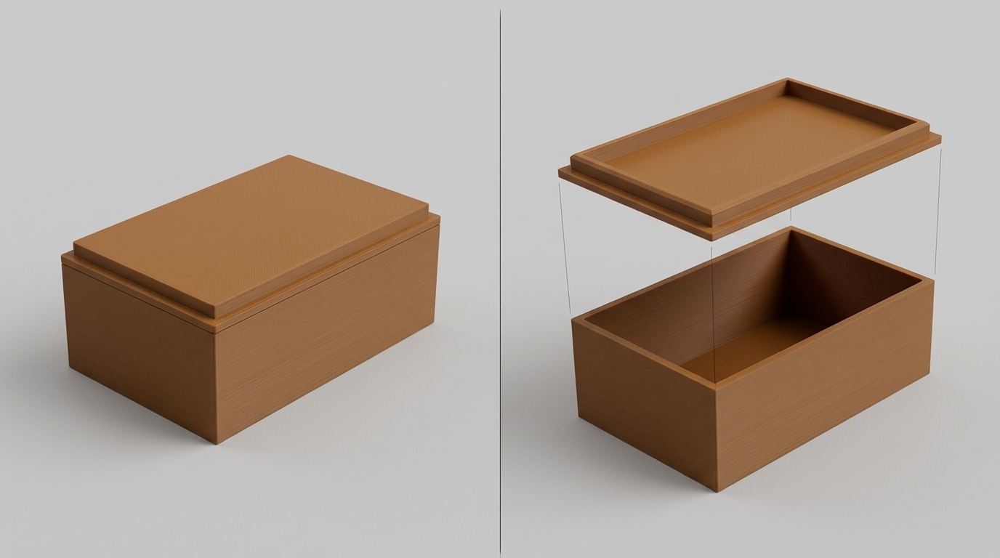
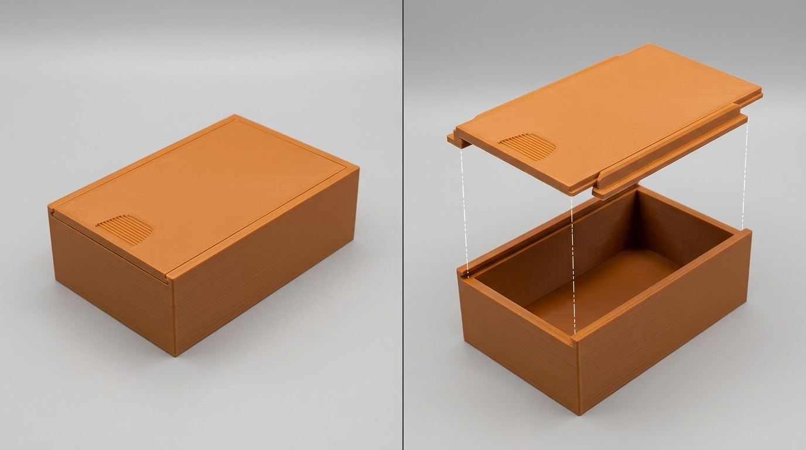

# Planejamento do Forja3D

Software de desktop para Windows em que você descreve uma peça em português e um agente de IA projeta, confere e fatia essa peça para a sua Creality Ender-3 V3 SE.

| Documento | Para que serve |
|---|---|
| Este plano | Decisões, fases e riscos |
| [PROMPT_DESENVOLVIMENTO.md](PROMPT_DESENVOLVIMENTO.md) | Prompt completo para uma IA de programação construir o software |
| [PROMPT_AGENTE_3D.md](PROMPT_AGENTE_3D.md) | Prompt de sistema do agente que roda dentro do app, com todos os padrões da impressora |

## 1. Como o produto funciona

1. Você escreve, por exemplo: "suporte em L para prateleira, com 2 furos M4".
2. O agente pergunta o que faltar, em até 3 perguntas.
3. Ele escreve um script CadQuery, que roda em um processo restrito.
4. O app mede a peça e compara com o pedido e com os limites da impressora.
5. O agente olha 6 imagens da peça e corrige o que estiver errado.
6. Você vê a peça em 3D sobre a mesa e aprova ou pede ajustes.
7. O OrcaSlicer fatia com o perfil oficial da máquina, e um validador confere o G-code.
8. Você clica em **Exportar** e leva o cartão SD até a impressora.

**Limite do produto:** o CadQuery serve bem para peças técnicas, como suportes, caixas, espaçadores e encaixes. Ele não serve para formas orgânicas, como bonecos e esculturas.

### Começar por uma imagem de referência

1. Você envia uma imagem no chat, com um pedido opcional.
2. Abre um diálogo, e o app gera **pelo menos 2 opções**. Cada opção é uma única imagem, com a peça montada de um lado e a vista explodida do outro.
3. Você escolhe uma, gera de novo ou pede mais opções.
4. O agente recebe a opção escolhida, pergunta as medidas que faltam e modela a peça de verdade.

Exemplos reais gerados no seu endpoint, para o pedido "caixa parecida para guardar um carregador":

| Opção 1: tampa sobreposta | Opção 2: tampa deslizante |
|---|---|
|  |  |

**A imagem é só uma ilustração do conceito.** Ela ajuda a escolher o caminho, mas não contém medidas nem vira arquivo de impressão. A peça final sai do CadQuery e pode ficar um pouco diferente da imagem, e o agente avisa o que mudou.

## 2. O que já existe na pasta

Você disse que ainda não tem nada criado, mas a pasta tem restos de uma tentativa anterior, chamada Forja3D, de hoje entre 01:11 e 02:21. **Os arquivos `.py` foram apagados às 02:21:03, um minuto antes desta análise.** Sobraram só `__init__.py` vazios e alguns `.pyc`, e o git não tem nenhum commit para recuperar o código.

Não apaguei nada disso. O plano reescreve o código e aproveita os dados:

| Item | Situação | Decisão |
|---|---|---|
| `config/impressora_ender3_v3_se.json` | Completo, conferido com os presets | Aproveitar |
| `config/orca/` | 8 presets vindos do perfil oficial do Orca | Aproveitar |
| `ferramentas/OrcaSlicer_2.4.2/` | ZIP igual à versão oficial, pelo SHA-256, e pasta igual ao ZIP. Gerou os G-codes de teste, mas ainda não executei o programa | Aproveitar |
| `.venv/` e `requirements.lock` | Python 3.11.9. CadQuery, PySide6, PyVista, trimesh e openai importam sem erro | Aproveitar |
| `src/forja3d/ia/prompts/agente_3d.md` | Era de boa qualidade e serviu de base para o novo `PROMPT_AGENTE_3D.md` | Substituído pelo novo na Fase 0 |
| `src/forja3d/agente/ferramentas.json` | Definição das 5 ferramentas | Aproveitar |
| Código Python em `src/forja3d/` | Não existe mais | Reescrever |
| `tests/dados/` | G-code de referência e um caso de teste | Aproveitar |
| `projetos/`, `saida/` | Resultados antigos | Só consulta, fora do git |

## 3. Decisões técnicas

| Tema | Decisão | Motivo |
|---|---|---|
| Linguagem | Python 3.11 | Todas as bibliotecas de CAD e malha estão nela |
| Interface | PySide6 | Desktop nativo no Windows |
| Visualização 3D | PyVistaQt | Mostra a peça na janela e gera as imagens para a IA |
| Modelagem | CadQuery | Código paramétrico e medidas exatas, com saída em STL e STEP |
| Medições | trimesh e manifold3d | Malha fechada, espessura, balanços |
| Fatiador | OrcaSlicer 2.4.2 em modo portátil | Tem perfil oficial da V3 SE e roda por linha de comando |
| IA | SDK `openai` apontando para o seu endpoint | O endpoint é compatível com a API da OpenAI |
| Imagens de conceito | `gemini-3.1-flash-image`, com uma chamada por opção | É o único modelo de imagem que funciona hoje no servidor |
| Envio à impressora | Cartão SD | É a rota confirmada para esta máquina |
| Empacotamento | PyInstaller em pasta | Já está no lock |

Três princípios guiam o projeto:

- **A IA nunca escreve G-code.** Ela só escreve CAD. Isso protege a impressora de temperatura ou movimento inventados.
- **As regras ficam no código.** A ordem das etapas, os limites e a aprovação são garantidos pelo app, mesmo que o modelo tente outra coisa.
- **Imprimir cedo.** Há um teste físico antes de construir a interface, porque até agora nada foi impresso de verdade.

## 4. Configuração da IA

| Campo | Valor padrão |
|---|---|
| Endpoint | `http://129.151.36.250:8317/v1` |
| Chave | A que você informou. Fica só no prompt de desenvolvimento e em `config/ia.json` |
| Modelo | `gemini-3.8-flash-high` |
| Modelo de imagem | `gemini-3.1-flash-image` |

**O nome "gemini 3.8" não funciona nesse servidor.** Ele devolve HTTP 400, `model_not_found`. O único modelo 3.8 listado é `gemini-3.8-flash-high`, então é esse o padrão.

Testei o endpoint hoje:

| Teste | Resultado |
|---|---|
| Lista de modelos | OK, 43 modelos |
| Resposta de texto | OK, 3,6 s |
| Chamada de ferramenta | OK |
| Ciclo completo: ferramenta, resultado, imagem e resposta | OK, nas duas formas de montar a mensagem |
| Leitura de imagem | OK. Descreveu certo um cubo com X, Y e Z gravados |
| Streaming de texto | OK |
| Streaming com ferramenta | OK |
| Gerar imagem a partir de uma referência | OK com `gemini-3.1-flash-image`, cerca de 9 s por imagem |
| Fluxo completo: análise, 2 opções e conferência | OK, 62 s. Uma opção precisou de segunda tentativa |
| Duas imagens na mesma chamada (`n=2`) | Não funciona, HTTP 400. O app faz 2 chamadas em paralelo |
| Modelos `gpt-image-*` | **Não funcionam hoje:** HTTP 503, `auth_unavailable`. Aparecem na lista, mas o servidor está sem credencial para eles |

O fluxo de imagem foi testado com uma única referência, um render simples de caixa. Ainda falta testar com fotos e esboços, o que está na Fase 5.

## 5. Arquitetura

```text
Imagem de referência (opcional)
   |
   v
Diálogo de conceitos: análise --> 2 ou mais imagens --> conferência --> você escolhe
   |
   v
Você (chat em português)
   |
   v
Interface PySide6 --- visualizador 3D --- painel de impressão
   |
   v
Agente (ciclo + guardas de estado) <---> Endpoint de IA
   |
   | ferramentas
   |-- definir_especificacao --> confere os limites da impressora
   |-- executar_cad ----------> processo restrito + CadQuery --> STL e STEP
   |-- verificar_peca --------> medidas, paredes, furos, balanços
   |-- renderizar_vistas -----> 6 imagens --> voltam para a IA
   '-- fatiar_peca -----------> OrcaSlicer --> validador de G-code
                                                   |
                         botão Exportar --> cartão SD --> impressora
```

A exportação não é uma ferramenta da IA: só você aciona, pelo botão. A estrutura de pastas e a especificação de cada módulo estão nas seções 7 e 8 do prompt de desenvolvimento.

## 6. Padrões da impressora e de onde vieram

| Item | Valor | Origem |
|---|---|---|
| Volume físico | 220 × 220 × 250 mm | Vendedores e perfil do Orca |
| Volume seguro | 210 × 210 × 239 mm | Calculado a partir do G-code final, que sobe 10,2 mm e move 5 mm em X e Y |
| Máximo em X e Y aceito pelo fatiador | 217 mm | Medido na tentativa anterior, em `saida/fase0` |
| Bico | 0,4 mm, latão, até 260 °C | Creality e perfil do Orca |
| Mesa | Aço-mola com PC, até 100 °C | Creality e vendedores |
| Velocidade e aceleração | 250 mm/s e 2500 mm/s² | Creality |
| Velocidade máxima em Z | 5 mm/s | Perfil do Orca |
| Camada | 0,10 a 0,35 mm pela Creality, até 0,32 mm no Orca. O app usa de 0,12 a 0,24 mm | Creality e perfil do Orca |
| Filamento | 1,75 mm: PLA, PETG e TPU 95A | Creality |
| Extrusor | Sprite direct drive, retração de 1,2 mm | Creality e perfil do Orca |
| Nivelamento | CR Touch com 16 pontos e sensor de tensão para o ajuste de Z | Vendedores e análises |
| Precisão | ±0,1 mm a cada 100 mm | Creality |
| Firmware | V1.1.0, de 11/05/2025. G-code no padrão Marlin | Creality e G-code gerado |
| Envio de arquivo | Cartão SD | Creality e printer-hub |
| Sensor de fim de filamento | Não vem de fábrica, é opcional | printer-hub |
| Potência | 350 W | printer-hub |

**Duas informações para conferir na sua máquina:**

- A página da Creality cita Creality Cloud e atualização OTA, mas o printer-hub diz que não há conexão sem fio. O plano usa só o cartão SD, então isso não bloqueia nada.
- Só o printer-hub informa que o sensor de filamento é opcional. O app assume que a sua máquina não tem, que é o caso mais seguro.

## 7. Fases

**Estado atual: Fase 0 concluída em 02/11/2026. A próxima é a Fase 1.**

Tamanho relativo: P (pequena), M (média), G (grande).

| Fase | Entrega | Tamanho | Pronta quando |
|---|---|---|---|
| 0. Fundação | Estrutura, git, teste do endpoint | P | Testes rodam e a chave não aparece no `git status` |
| 1. Núcleo sem IA | CAD, verificação, fatiamento e validador, por terminal | M | Cubo de 20 mm gera G-code aprovado nos 3 materiais e nas 4 qualidades |
| **Portão físico 1** | **Imprimir cubo e peça com furos** | P | **Cubo mede 20 mm ±0,2 mm e a primeira camada está uniforme** |
| 2. Agente em terminal | Ciclo com IA, ferramentas e imagens | M | Conjunto de 10 pedidos atinge as metas |
| 3. Interface | Chat, 3D, painel, Aprovar, Exportar | G | Fluxo completo só pela janela |
| 4. Projetos | Salvar, reabrir, versões | P | Recupera tudo depois de fechar o app |
| 5. Imagem de referência | Diálogo com 2 ou mais opções, cada uma com montada e explodida | M | Funciona com foto, esboço e render, e o agente pergunta as medidas depois da escolha |
| 6. Calibração | Peças de teste e medidas que alimentam o agente | P | Medidas alteram os furos gerados |
| **Portão físico 2** | **Imprimir uma peça real que encaixe em algo** | P | **Encaixa na primeira ou na segunda impressão** |
| 7. Empacotamento | Pasta instalável com Orca | M | Roda em um usuário sem Python |

Depois da v1, se fizer sentido:

- Importar um STL para adaptar.
- Vista explodida real, feita a partir do modelo CAD, no visualizador 3D.
- Biblioteca de peças prontas.
- Mostrar o G-code camada por camada.

## 8. Como medir se o agente está bom

São 10 pedidos fixos, detalhados na seção 11 do prompt de desenvolvimento:

- **7 de geometria,** como cubo, suporte em L, caixa com tampa e gancho. A meta é acertar pelo menos 6 sem ajuda.
- **3 de comportamento:** peça grande demais, pedido vago e medida crítica faltando. O agente precisa parar e perguntar sem chamar ferramenta, e esses 3 têm que passar sempre.

O fluxo de imagem tem mais 5 casos, como foto real, imagem de arma, texto malicioso dentro da imagem e peça de um único componente.

## 9. Riscos

| Risco | Impacto | O que fazer |
|---|---|---|
| **Endpoint em HTTP, sem criptografia** | Quem estiver no caminho da rede pode ler a chave e alterar respostas, inclusive o código que o app vai executar | Colocar HTTPS no servidor, com um proxy reverso. O app já trata toda resposta como não confiável |
| **Código gerado por IA roda no seu PC** | Um script malicioso ou errado pode causar dano | Três barreiras: análise do código, processo separado com limites e auditoria em execução. Reduz o risco, mas não é uma proteção perfeita, então nunca rode o app como administrador |
| **Chave em arquivo de texto** | Vaza se o repositório for público | `config/ia.json` e o prompt de desenvolvimento ficam no `.gitignore` |
| **Imagens de referência trafegam sem criptografia** | Fotos suas podem ser lidas no caminho da rede | O app remove GPS e outros metadados antes de enviar. A solução completa é o HTTPS. Evite enviar imagens com dados pessoais |
| **Modelo de imagem pode gerar painéis diferentes entre si** | Parafusos a mais ou tampa que muda entre montada e explodida | Lista exata de componentes no prompt, conferência automática e até 3 tentativas. A conferência também é feita por IA, então pode falhar |
| **Só um modelo de imagem funciona hoje** | Se ele sair do ar, os conceitos param, mas o resto do app continua | Você pode trocar o modelo em Configurações. Para usar os `gpt-image-*`, o servidor precisa de credencial para eles |
| **Conceito bonito que não imprime bem** | A imagem não respeita a física nem as medidas | O agente avisa e adapta antes de modelar, e a verificação da peça continua valendo |
| **Nada foi impresso até agora** | O fatiador aceitar não garante boa peça | Portão físico 1 antes da interface |
| **O G-code inicial só faz `G28`, sem `G29` nem `M420`** | A malha de nivelamento pode não ser usada como você imagina | Rodar o nivelamento pelo menu e conferir a primeira camada no Portão 1. Não alterar o G-code sem esse teste |
| **Servidor intermediário pode mudar** | O modelo pode sumir da lista | O app confere `/v1/models` ao abrir e deixa você escolher outro |
| **Orca por linha de comando é frágil** | Trocar a ordem dos presets gerou arquivos de tamanhos diferentes, com causa desconhecida | Versão fixa, ordem fixa e teste contra o G-code de referência. Investigar a causa na Fase 1 |
| **CadQuery e VTK no PyInstaller** | O pacote pode falhar ou ficar grande | Testar uma versão mínima já na Fase 1 |
| **Licença do OrcaSlicer (AGPL)** | Só importa se você distribuir o app para outras pessoas | Rever antes de distribuir |

## 10. Como começar

1. Se apagar os `.py` foi sem querer, saiba que eles não têm como voltar pelo git. Sobraram só alguns `.pyc`.
2. Abra uma sessão nova de IA de programação nesta pasta.
3. Envie: `Leia docs/PROMPT_DESENVOLVIMENTO.md e execute a próxima fase pendente.`
4. Ao chegar no Portão físico 1, tenha à mão um paquímetro, filamento PLA e parafusos M3 e M4.

## Fontes

- [Creality: suporte da Ender-3 V3 SE](https://www.creality.com/br/support/creality-ender-3-v3-se)
- [Printer-hub: ficha da Ender-3 V3 SE](https://printer-hub.com/printers/creality-ender-3-v3-se)
- [Printer-hub: análise da Ender-3 V3 SE](https://printer-hub.ru/en/posts/creality-ender-3-v3-se-review)
- [3DJake: Creality Ender 3 V3 SE](https://www.3djake.com/creality-3d-printers-spare-parts/ender-3-v3-se)
- [Filament2Print: Creality Ender-3 V3 SE](https://filament2print.com/gb/filament-fdm/2385-creality-ender3-v3-se.html)
- Perfil oficial no OrcaSlicer 2.4.2: `Creality Ender-3 V3 SE 0.4 nozzle`, copiado em `config/orca/maquina.json`
