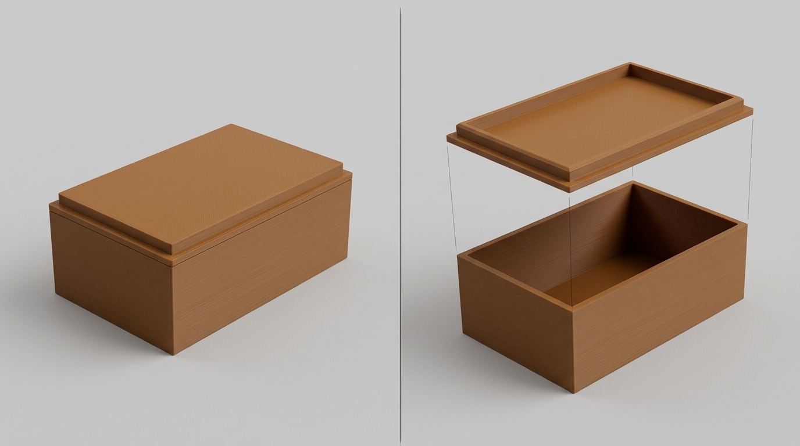
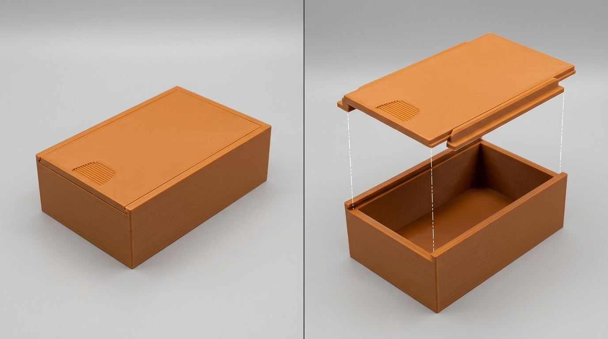

# Função: imagem de referência

O usuário envia uma imagem de referência pelo botão **Imagem de referência** do chat, arrastando ou colando. Abre um diálogo com pelo menos 2 opções de conceito, e cada opção é uma única imagem com a peça montada e a vista explodida, com os componentes separados. O usuário escolhe uma, e o agente segue o fluxo normal a partir dela.

| Opção 1: tampa sobreposta | Opção 2: tampa deslizante |
|---|---|
|  |  |

**A imagem é ilustração, não projeto.** Ela nunca vira medida, STL nem G-code. A peça real sai do CadQuery e passa pela verificação de sempre.

## Onde está no código

| Arquivo | O que faz |
|---|---|
| `src/forja3d/conceitos/referencia.py` | Prepara a imagem: formato, 10 MB, rotação, 1536 px e remoção de todos os metadados |
| `src/forja3d/conceitos/fluxo.py` | Análise, geração em paralelo, conferência, tentativas e escolha |
| `src/forja3d/ia/prompts/conceito_analise.md` | Propõe 2 conceitos e lista componentes e medidas críticas |
| `src/forja3d/ia/prompts/conceito_imagem.md` | Pede a imagem com os dois painéis e as quantidades exatas |
| `src/forja3d/ia/prompts/conceito_conferencia.md` | Confere se os dois painéis batem |
| `src/forja3d/ia/cliente.py` | `gerar_imagem` e o erro `ModeloIndisponivel` |
| `src/forja3d/interface/dialogo_conceitos.py` | O diálogo com os cartões |
| `src/forja3d/interface/painel_chat.py` | Botão, arrastar e colar |
| `src/forja3d/agente/orquestrador.py` | `processar_conceito` e a imagem do conceito junto às vistas |
| `PROMPT_AGENTE_3D.md` | Seção "Imagem de referência e conceito escolhido" |

O modelo de imagem fica em `config/ia_padrao.toml`, no campo `modelo_imagem`, e pode ser trocado em **Configurações**.

Na pasta da peça:

```text
projetos/<peca>/
  referencias/
    referencia_01.png
  conceitos/
    rodada_01/
      analise.json
      opcao_1_01.png, opcao_1_02.png, opcao_2_01.png
      conferencia.json
    conceito_escolhido.json
```

Toda tentativa fica guardada, inclusive as reprovadas.

## Como funciona

É um fluxo do app, iniciado pelo usuário, e não uma ferramenta do agente.

1. **Receber a referência.** Aceita PNG, JPG e WEBP de até 10 MB. Aplica a rotação do EXIF, reduz o maior lado para 1536 px, regrava em PNG e **remove todos os metadados, inclusive GPS**, porque a imagem trafega sem criptografia.
2. **Analisar.** O modelo de texto recebe a referência e o pedido e propõe 2 conceitos. Se recusar, o diálogo mostra o motivo e não gera imagem.
3. **Gerar.** Uma chamada por opção, em paralelo, com a referência anexada.
4. **Conferir.** O modelo de texto confere cada imagem. Se reprovar, gera de novo, com no máximo 3 tentativas por opção. Depois disso, mostra a última imagem com um aviso.
5. **Escolher.** Cada cartão tem **Escolher esta** e **Gerar de novo**. O diálogo tem **Mais 2 opções** e **Refazer com este pedido**, e as opções anteriores continuam na tela.
6. **Passar para o agente.** O agente recebe o texto `[CONCEITO ESCOLHIDO]`, com componentes e medidas críticas, mais a referência e a imagem escolhida.

## Regras garantidas no código

- **Mínimo de 2.** **Escolher esta** fica desativado até existirem 2 imagens prontas. O app nunca escolhe pelo usuário.
- **Modelo indisponível.** O app não troca de modelo em silêncio: mostra o erro e oferece abrir as Configurações.
- **Texto da IA é dado.** Título, descrição e componentes aparecem como texto puro, sem interpretar HTML.
- **Nada da internet.** Arrastar um link remoto não baixa nada: só arquivos locais e imagens copiadas contam.
- **Imagem não vira peça.** Escolher um conceito não cria versão nem libera aprovação ou exportação.

## O que foi medido no endpoint

| Item | Resultado |
|---|---|
| `gemini-3.1-flash-image` em `POST /v1/chat/completions`, com a referência em `image_url` | Funciona, de 7 a 10 s por imagem |
| Onde a imagem vem na resposta | `choices[0].message.images[0].image_url.url`, como data URI. `content` vem nulo. No SDK `openai`, fica em `message.model_extra["images"]` |
| Formato e tamanho | JPEG nos testes. Saiu 1376 × 768 quando o prompt pediu imagem horizontal e 1024 × 1024 sem esse pedido |
| Mais de uma imagem por chamada | **Não funciona.** `n=2` devolve HTTP 400, `Only one candidate can be specified` |
| `gemini-3.1-flash-image` em `/v1/images/generations` e `/v1/images/edits` | Não funciona, HTTP 400 |
| `gpt-image-1.5`, `gpt-image-2`, `gpt-image-2.5`, `gpt-image-2.5-flare`, `gpt-image-2.5-sunburst` | **Aparecem na lista, mas não geravam em 02/11/2026:** HTTP 503, `auth_unavailable`. Esse erro é do servidor, então não adianta repetir |
| `response_format: json_object` no modelo de texto | É aceito, mas o JSON ainda veio entre cercas de código, que o app remove |

## Limites conhecidos

- **O modelo de imagem erra a consistência entre os painéis com frequência.** Em um teste, uma imagem tinha 4 parafusos montada e 6 na explodida, e a conferência percebeu. A conferência também é feita por IA, então pode deixar passar algo.
- **Peça inteiriça é o caso mais difícil.** O modelo tende a inventar uma divisão na vista explodida. Por isso a análise lista também o que acompanha a peça, como parafusos.
- **Ainda não foi testado com uma foto real.** Os testes usaram um render e um esboço.
